# Session 21 — Final DevOps Project: Kirana Ledger

The capstone for the course, following the
[Session 21 brief](https://github.com/Nency-Ravaliya/devops-heros/tree/main/session21-python).
The brief's reference app is *TaskBoard*; the rules say the application domain must be your own, so this
project is **Kirana Ledger**, a credit book (*udhar khata*) for a small Indian grocery shop. The DevOps layer
follows the same architecture as TaskBoard.

| Document | What it covers |
|---|---|
| **README.md** (this file) | Project overview, requirements, how to run every layer, evidence |
| [GRADING.md](GRADING.md) | The rubric (M1–M10, 100 points) and a self-assessment against it, with evidence |
| [student-guide.md](student-guide.md) | Submission instructions, evidence checklist and the final demo script |
| [presentation/](presentation/index.html) | The final presentation: 17 slides ([HTML](presentation/index.html), [PDF](presentation/Kirana-Ledger-Session21.pdf)) |

**Current release: 2.1.0**, running on minikube through Argo CD and deployed on every push by the pipeline.

---

## 1. The application

A shopkeeper records three kinds of entries:

| Type | Meaning | Effect on balance |
|---|---|---|
| `udhar` | Goods given on credit | balance goes **up** |
| `payment` | Customer pays back credit | balance goes **down** |
| `sale` | Cash sale | counted in today's takings |

The app shows *कौन कितना बाकी* (who owes how much), biggest balance first, with a one-tap WhatsApp reminder:
`Ramesh ji, ₹300 बाकी हैं.` Customer names are stored without honorifics, so "Ramesh bhai", "Rameshbhai" and
"Shri Ramesh ji" all count as one customer, "Ramesh".

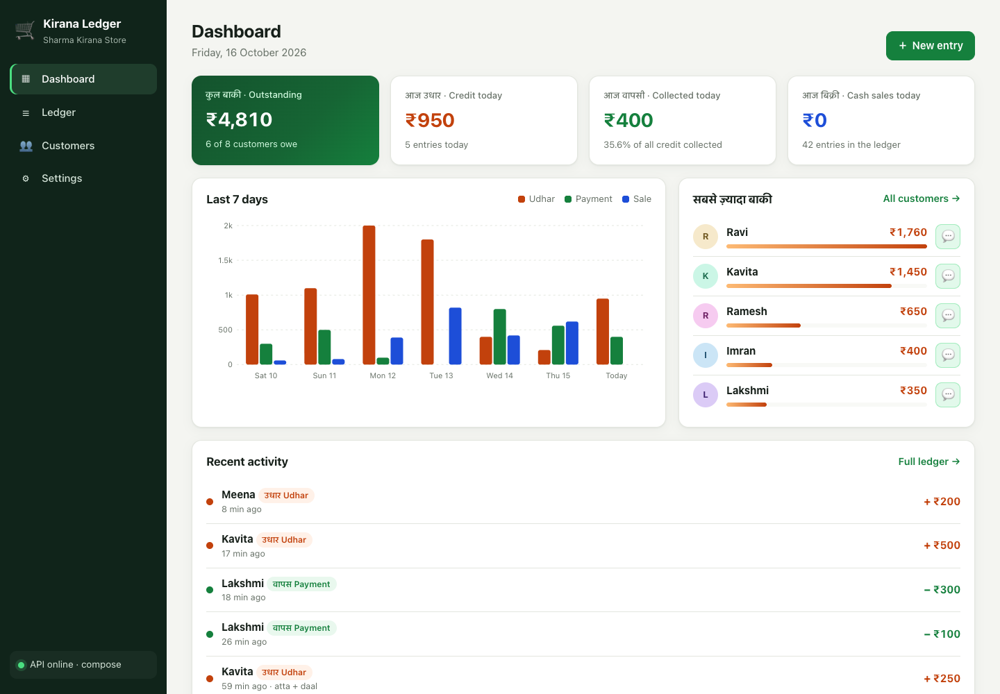

| | |
|---|---|
| 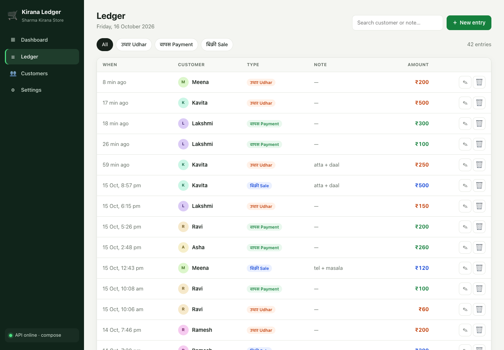 | 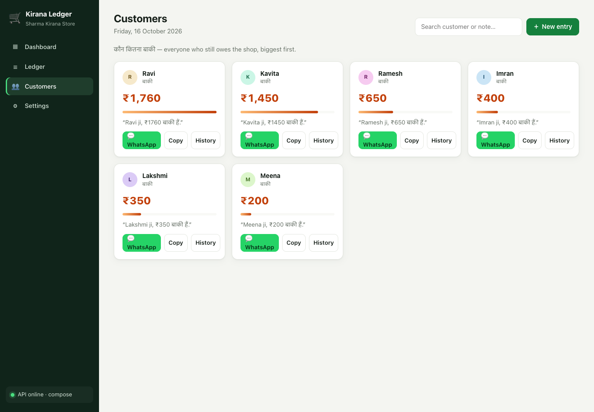 |
| 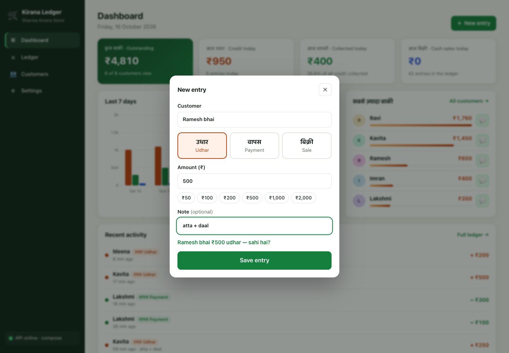 | 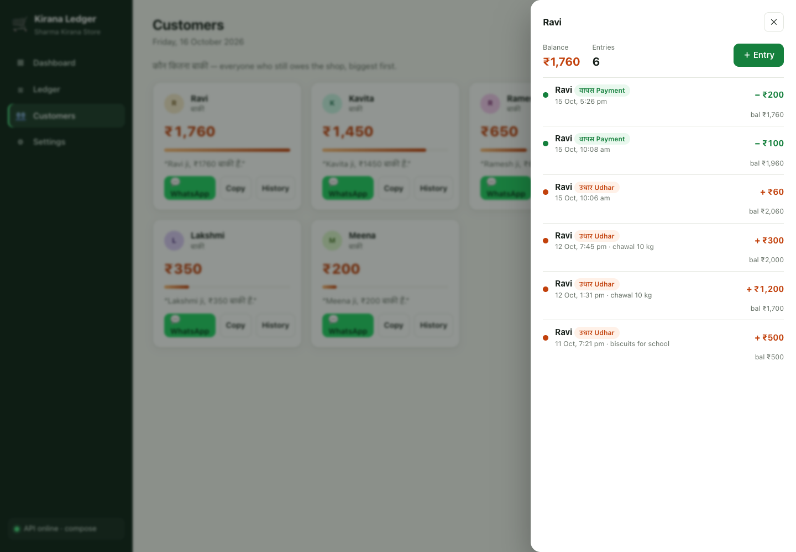 |

| Phone | Phone | Dark mode |
|---|---|---|
| 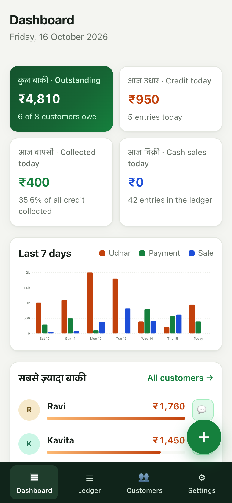 | 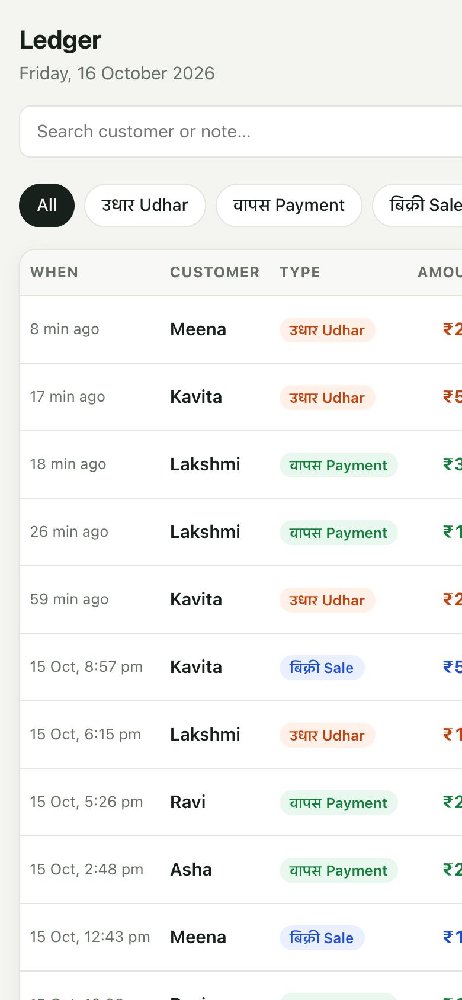 | 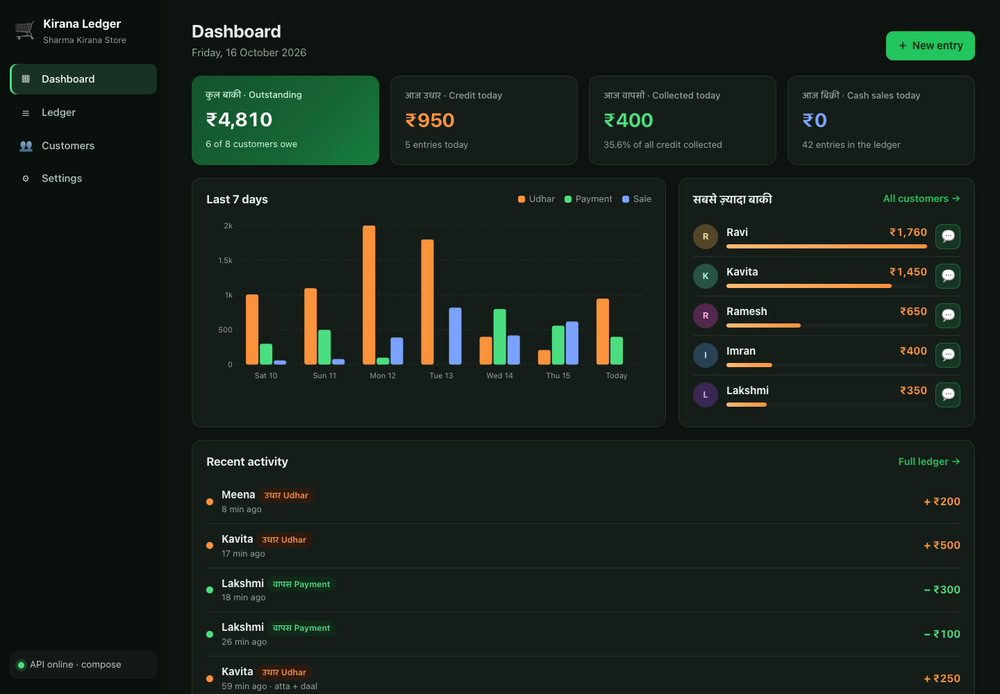 |

**What the UI does:** dashboard with four KPI cards (outstanding credit, credit given / collected / cash sales
today), a 7-day udhar/payment/sale chart, top dues with WhatsApp reminder links, a recent-activity feed; a ledger
table with type filters and search, plus edit and delete; customer cards with a running-balance history; an entry dialog
with big type buttons, quick amounts and a *"Ramesh bhai ₹500 udhar — sahi hai?"* confirmation line; toasts,
an API status indicator, a bottom tab bar on phones and automatic dark mode.

### Architecture

```text
Developer ──git push──> GitHub ──> GitHub Actions (s21-final.yml, 17 jobs)
                                     ├─ 1  pytest + flake8 + coverage ≥ 80 %, frontend build
                                     ├─ 2  SAST (Semgrep)
                                     ├─ 3  SCA (pip-audit, npm audit, Trivy fs)
                                     ├─ 4  Secret scan (Gitleaks)
                                     ├─ 5  IaC scan (Trivy config, terraform validate, helm lint)
                                     ├─ 6  Docker build: 2 tiers × amd64 / arm64 (native runners)
                                     ├─ 7  Trivy image scan × 4
                                     ├─ 8  Security gate (all of 2–7 must pass)
                                     ├─ 9  Push to GHCR: one multi-arch image per tier, tag = git SHA
                                     └─ 10 helm upgrade --install on a kind cluster + smoke test

Terraform ──> AWS VPC (2 public + 2 private subnets, NAT) ──> EKS + managed node group, ECR

Kubernetes (namespace kirana, Helm chart "kirana")          ◀── Argo CD syncs helm/kirana from main (minikube)
   Ingress kirana.local ── /     ──> frontend Service ──> Nginx Pods (HPA)
                        └─ /api  ──> backend Service  ──> FastAPI Pods (HPA) ──> PostgreSQL StatefulSet + PVC
                                                             └─ /metrics ──> ServiceMonitor ──> Prometheus ──> Grafana
```

### Tech stack

| Layer | Choice |
|---|---|
| Frontend | Vanilla JS + CSS built with Vite, served by unprivileged Nginx (multi-stage image) |
| Backend | FastAPI, SQLAlchemy 2, Pydantic, `prometheus-fastapi-instrumentator` |
| Database | PostgreSQL 17, schema managed by Alembic (`0001_create_entries`) |
| Tests | pytest + pytest-cov against a throwaway SQLite DB per test; flake8 |
| Containers | Docker, Docker Compose (postgres → migrate → backend → frontend) |
| CI/CD | GitHub Actions (amd64 + arm64 runners), GHCR, Helm deploy to kind |
| Security | Semgrep, pip-audit, npm audit, Gitleaks, Trivy (fs, config, image) |
| IaC | Terraform: VPC, subnets, NAT, EKS, node group, EBS CSI add-on, KMS, ECR |
| Kubernetes | Helm chart: Deployments, StatefulSet, Services, Ingress, HPA, ConfigMap, Secret |
| Observability | kube-prometheus-stack, ServiceMonitor, PrometheusRule (3 alerts), Grafana dashboard |
| GitOps | Argo CD `Application` with auto-sync, prune and self-heal |

### REST API (12 endpoints)

| Method | Path | Purpose |
|---|---|---|
| GET | `/health` | Liveness: process is up, never touches the DB |
| GET | `/ready` | Readiness: DB answers `SELECT 1`, else 503 |
| GET | `/metrics` | Prometheus metrics, incl. `kirana_ledger_entries_total{type}` |
| GET | `/api/info` | Shop name and version (the git SHA in CI-built images) |
| GET | `/api/stats` | Outstanding credit, today's totals, collection rate, per-day trend (`?days=1..90`, IST) |
| GET | `/api/entries` | List, newest first: `?customer=`, `?type=udhar\|payment\|sale`, `?q=` (search), `?limit=` |
| GET | `/api/entries/{id}` | One entry |
| POST | `/api/entries` | Create entry (`X-API-Key` header) |
| PUT | `/api/entries/{id}` | Update entry (`X-API-Key`) |
| DELETE | `/api/entries/{id}` | Delete entry (`X-API-Key`) |
| GET | `/api/customers` | Outstanding balances, biggest first, with reminder text |
| GET | `/api/customers/{name}` | One customer's balance |

Swagger UI: `/docs` on the backend.

---

## 2. Requirements

| Requirement from the brief | Where it is |
|---|---|
| Frontend, backend, PostgreSQL | [`application/frontend`](final-devops-project/application/frontend), [`application/backend`](final-devops-project/application/backend) |
| ≥ 4 REST APIs, responsive UI | 12 endpoints above; desktop, phone and dark-mode screenshots |
| Git/GitHub | this repo, `main` |
| Automated tests | [`backend/tests`](final-devops-project/application/backend/tests): 21 tests, 91.6 % coverage |
| Docker | two Dockerfiles + [`docker/docker-compose.yml`](final-devops-project/docker/docker-compose.yml) |
| GitHub Actions | [`.github/workflows/s21-final.yml`](../.github/workflows/s21-final.yml) |
| Security scan | Trivy + Semgrep + Gitleaks + pip-audit/npm audit; config in [`security/`](final-devops-project/security) |
| Container registry | GHCR: `ghcr.io/milap1afk/kirana-backend`, `ghcr.io/milap1afk/kirana-frontend` (public, multi-arch) |
| Terraform | [`terraform/`](final-devops-project/terraform) |
| Kubernetes + Helm | [`k8s/`](final-devops-project/k8s), [`helm/kirana`](final-devops-project/helm/kirana), plain YAML in [`kubernetes/`](final-devops-project/kubernetes) |
| Ingress, HPA | [`ingress.yaml`](final-devops-project/helm/kirana/templates/ingress.yaml), [`hpa.yaml`](final-devops-project/helm/kirana/templates/hpa.yaml) |
| Prometheus/Grafana | [`monitoring/`](final-devops-project/monitoring) + chart templates `servicemonitor`, `prometheusrule`, `grafana-dashboard` |
| Troubleshooting | two real incidents (section 9), [`troubleshooting/resilience-check.sh`](final-devops-project/troubleshooting/resilience-check.sh) |
| Final presentation | [presentation/](presentation/index.html) + recorded live-demo evidence (section 8) |

Tools used locally: macOS (Apple Silicon, 8 GB), Colima (Docker 29), minikube (Kubernetes 1.37), Helm, Terraform 1.16, kubectl, Argo CD.

### Repository layout

```text
session-21-final-devops-project/
├── README.md  GRADING.md  student-guide.md
├── presentation/                    # index.html (17 slides) + Kirana-Ledger-Session21.pdf
├── screenshots/                     # app, cluster, monitoring, pipeline, terminal evidence
├── output-*.txt, compose-up-build.txt  # captured terminal output (evidence)
└── final-devops-project/
    ├── application/
    │   ├── backend/                 # FastAPI app, alembic/, tests/, app/seed.py, Dockerfile, pytest.ini
    │   └── frontend/                # Vite source, nginx.conf.template, multi-stage Dockerfile
    ├── docker/docker-compose.yml    # full local stack
    ├── terraform/                   # VPC + EKS + ECR, terraform.tfvars.example, output.txt
    ├── k8s/namespace.yaml           # bootstrap
    ├── helm/kirana/                 # the chart (values.yaml, values-minikube.yaml, templates/, dashboards/)
    ├── kubernetes/                  # same resources as plain YAML, rendered by render.sh
    ├── monitoring/                  # kube-prometheus-stack values, ServiceMonitor, PrometheusRule
    ├── gitops/argocd-application.yaml
    ├── scripts/deploy-minikube.sh   # Helm deploy of a pipeline SHA (when not using Argo CD)
    ├── security/                    # trivy.yaml, .gitleaks.toml, .semgrepignore
    └── troubleshooting/resilience-check.sh
```

---

## 3. Run it locally (Docker Compose)

```bash
cd session-21-final-devops-project/final-devops-project
docker compose -f docker/docker-compose.yml up --build -d
docker compose -f docker/docker-compose.yml exec backend python -m app.seed   # optional: a week of demo data
```

| URL | What |
|---|---|
| http://localhost:3000 | the app (Nginx proxies `/api` to the backend) |
| http://localhost:8001/docs | Swagger UI (host port 8001, because 8000 is often taken) |
| http://localhost:8001/health · `/ready` · `/metrics` | ops endpoints |

The local API key for writes is `local-dev-key`: enter it once under **Settings** (override with `API_KEY=...`).
Stop with `docker compose -f docker/docker-compose.yml down` (add `-v` to delete the database volume).
`app.seed` only fills an empty ledger: about 40 entries over the last 7 days, where nobody pays back more than they owe.

Verified on 2026-10-16: all four services up (`migrate` exited 0, backend healthy), the dashboard screenshots
above come from this stack, and [output-metrics.txt](output-metrics.txt) shows `/api/stats` and `/metrics` output.

### Backend tests

```bash
cd final-devops-project/application/backend
python3.12 -m venv .venv && source .venv/bin/activate
pip install -r requirements-dev.txt
flake8 . && pytest -v --cov=app
```

Result: **21 passed**, total coverage **91.6 %** (CI fails below 80 %): [output-pytest.txt](output-pytest.txt),
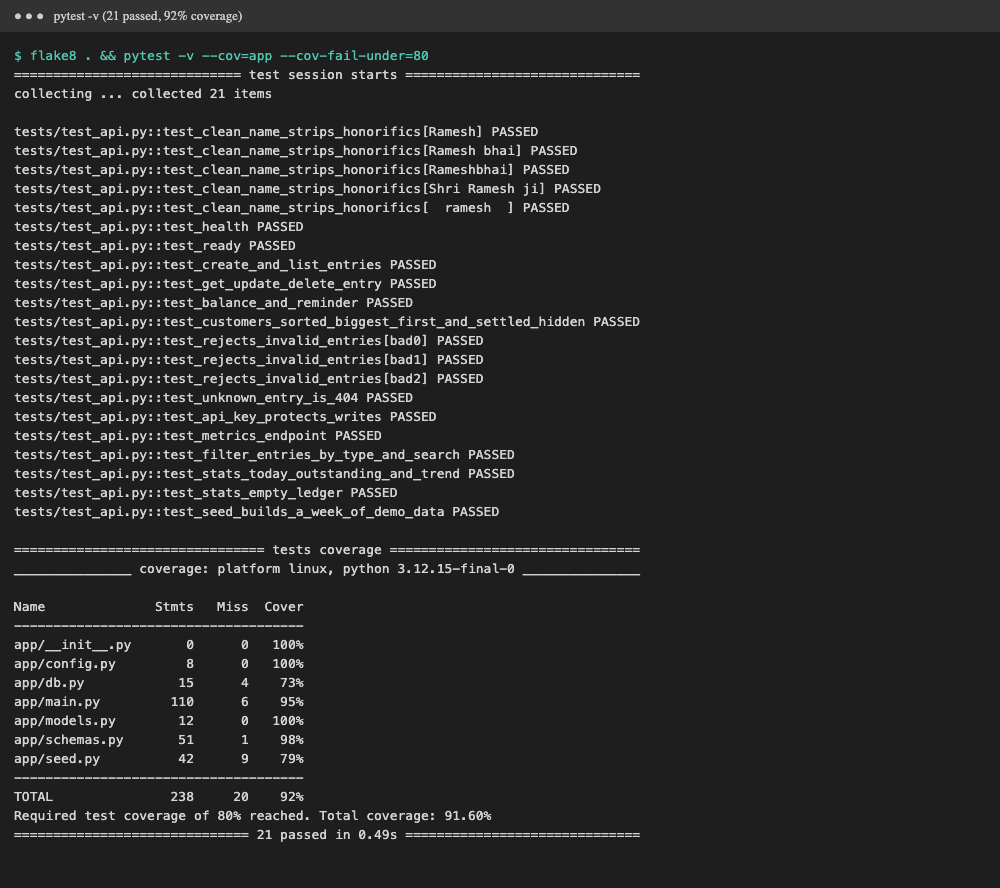

Tests use a fresh SQLite file per test via a FastAPI dependency override, never the real PostgreSQL. They cover
CRUD, balances and reminders, honorific stripping, filters and search, `/api/stats`, API-key auth, 404/422
handling, `/metrics` and the demo-data generator.

---

## 4. CI/CD pipeline

[`.github/workflows/s21-final.yml`](../.github/workflows/s21-final.yml) runs on every push to `main` that touches
this project (and on PRs, without the push/deploy jobs). Each tier is built natively on an amd64 runner
(`ubuntu-latest`) and an arm64 runner (`ubuntu-24.04-arm`). All four images are Trivy-scanned, then pushed and
joined into **one multi-arch tag per commit SHA** with `docker buildx imagetools create`, never `latest`. The same
tag therefore runs on GitHub's amd64 kind cluster, on EKS and on an Apple Silicon minikube.

Latest green run, all **17 jobs** passing:
<https://github.com/milap1afk/devops-homework/actions/runs/38857331818> (commit `41ee491`).

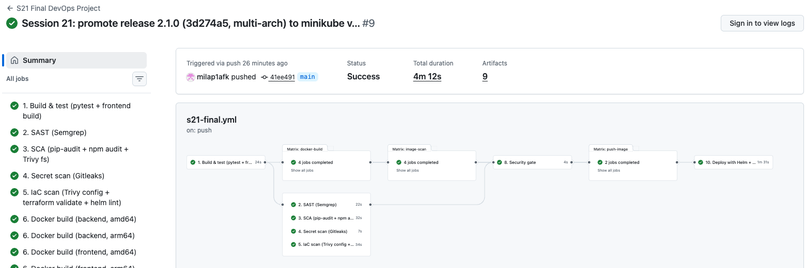

Its deploy job installs the chart on kind and prints `helm list` (revision 1, `kirana-2.1.0`, deployed), the
Deployments, Services, Ingress, HPAs and 2 + 2 Pods `Running`. It then smoke-tests the UI title, a POST and a
balance read through the frontend: [output-ci-helm.txt](output-ci-helm.txt).

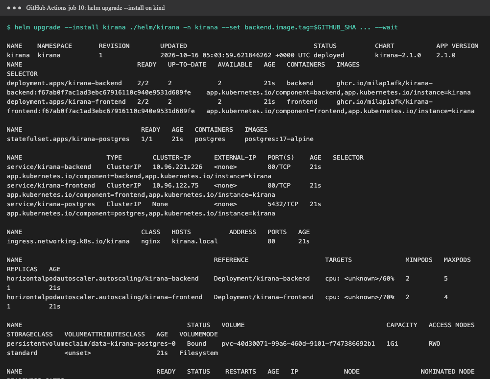

Published images (public): 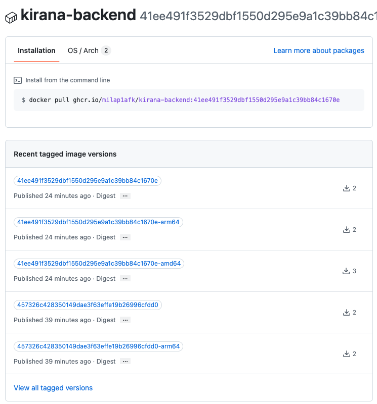

### Security scanning

| Stage | Tool | Blocks on |
|---|---|---|
| SAST | Semgrep (`p/python`, `p/fastapi`, `p/javascript`, `p/dockerfile`, `p/nginx`, `p/secrets`) | any finding |
| SCA | pip-audit, npm audit, Trivy fs | known vulnerable dependency |
| Secrets | Gitleaks over git history and files | any secret |
| IaC | Trivy config (Terraform, Helm, YAML, Dockerfiles), `terraform validate`, `helm lint` | HIGH/CRITICAL misconfig |
| Images | Trivy image, 2 tiers × 2 architectures | fixable HIGH/CRITICAL CVE |

Trivy reports **0** fixable HIGH/CRITICAL vulnerabilities in all four images (backend: Debian 13.7 + 31 Python
packages; frontend: Alpine 3.23.4): [output-trivy.txt](output-trivy.txt). The Dockerfiles run
`apt-get upgrade` / `apk upgrade` at build time for that reason, and both images run as non-root
(uid 10001 and 101).

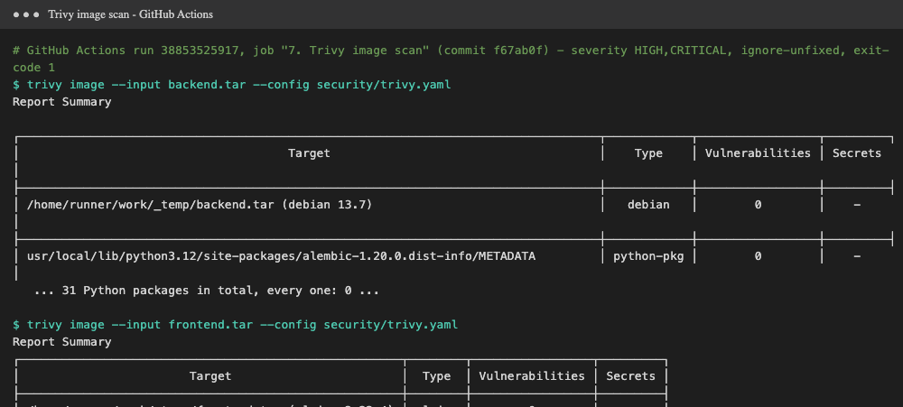

---

## 5. Terraform (AWS)

[`terraform/`](final-devops-project/terraform) describes, in `ap-south-1`: a VPC with 2 public and 2 private
subnets, an internet gateway, a NAT gateway, route tables, an EKS cluster (secrets encrypted with KMS) with a
managed node group and the EBS CSI add-on, IAM roles, and an ECR repository with a lifecycle policy.

```bash
cd final-devops-project/terraform
cp terraform.tfvars.example terraform.tfvars    # never commit the real one
# delete the "offline_plan = true" line in terraform.tfvars to talk to a real AWS account
terraform init && terraform plan
terraform apply                                 # creates billable resources (EKS + NAT)
$(terraform output -raw kubeconfig_command)     # aws eks update-kubeconfig --region ap-south-1 --name kirana-eks
terraform destroy                               # always, when done
```

[`run.sh`](final-devops-project/terraform/run.sh) runs `init`, `fmt -check`, `validate` and `plan` offline with
dummy credentials. The result is in [`output.txt`](final-devops-project/terraform/output.txt):
**Plan: 26 to add, 0 to change, 0 to destroy.** CI also runs `fmt -check` and `validate` and scans the code with
Trivy. Not done yet: `apply`/`destroy` against a real AWS account (see [GRADING.md](GRADING.md#m7--terraform-15)).

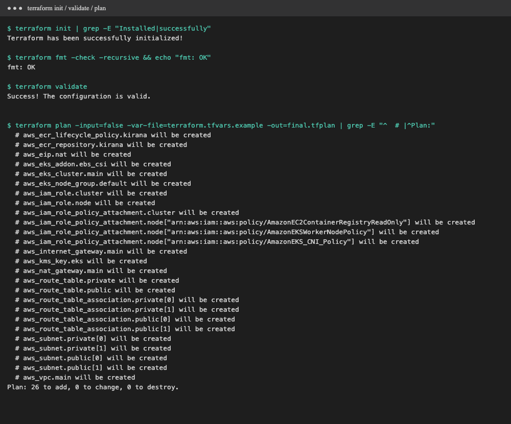

---

## 6. Kubernetes, Helm, Ingress, HPA

On minikube, Argo CD deploys the chart from `main`
([`gitops/argocd-application.yaml`](final-devops-project/gitops/argocd-application.yaml),
[`values-minikube.yaml`](final-devops-project/helm/kirana/values-minikube.yaml)). Bootstrapping:

```bash
cd final-devops-project
kubectl apply -f k8s/namespace.yaml
kubectl -n kirana create secret generic kirana-secrets \
  --from-literal=API_KEY="$(openssl rand -hex 16)" --from-literal=POSTGRES_PASSWORD="$(openssl rand -hex 16)"
kubectl apply -f gitops/argocd-application.yaml        # GitOps: Argo CD keeps the cluster = main
# or, without Argo CD:  scripts/deploy-minikube.sh <git-sha>   (helm upgrade --install with the CI images)
```

- **Backend Deployment**: an `initContainer` runs `alembic upgrade head` (retrying until Postgres is up);
  liveness `/health`, readiness `/ready`, startup probe; HPA 2–3 at 60 % CPU on minikube (2–5 by default).
- **Frontend Deployment**: Nginx on 8080, HPA 2–3 (2–4 by default).
- **PostgreSQL StatefulSet** with a 1 Gi PVC and deliberately patient probes (see incident 1).
- **Services**: ClusterIP for all three tiers.
- **Ingress** `kirana.local`: `/api` → backend, `/` → frontend (ingress-nginx).
- **Secrets** never live in Git: either `existingSecret` or `--set secrets.*` at install time.

Cluster after the 2.1.0 rollout ([output-cluster-after.txt](output-cluster-after.txt); before:
[output-cluster-before.txt](output-cluster-before.txt)):

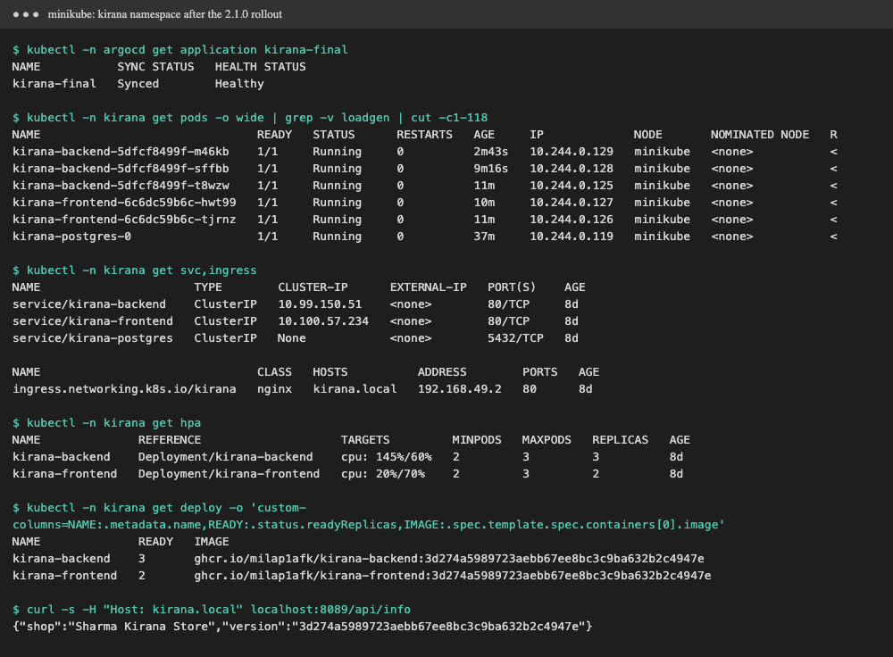

The app through the Ingress at `http://kirana.local`, served by the CI-built image (status shows `3d274a5`):

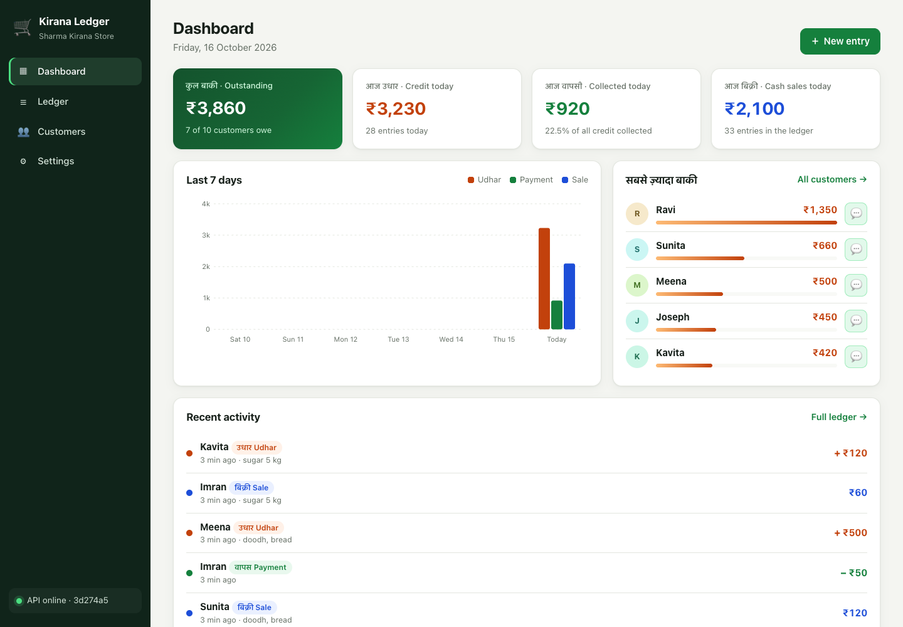

### HPA in action

About 2.5 minutes of traffic through the Ingress pushed backend CPU to 150 % of its request (target 60 %). The
HPA added a third Pod: *"New size: 3; reason: cpu resource utilization (percentage of request) above target"*
([output-hpa.txt](output-hpa.txt)). The load loop used:

```bash
kubectl -n ingress-nginx port-forward svc/ingress-nginx-controller 8089:80 &
end=$((SECONDS+150)); while [ $SECONDS -lt $end ]; do
  for p in /api/stats /api/entries /api/customers /api/info; do curl -s -o /dev/null -H 'Host: kirana.local' "localhost:8089$p"; done
done
kubectl -n kirana get hpa -w            # in a second terminal
```

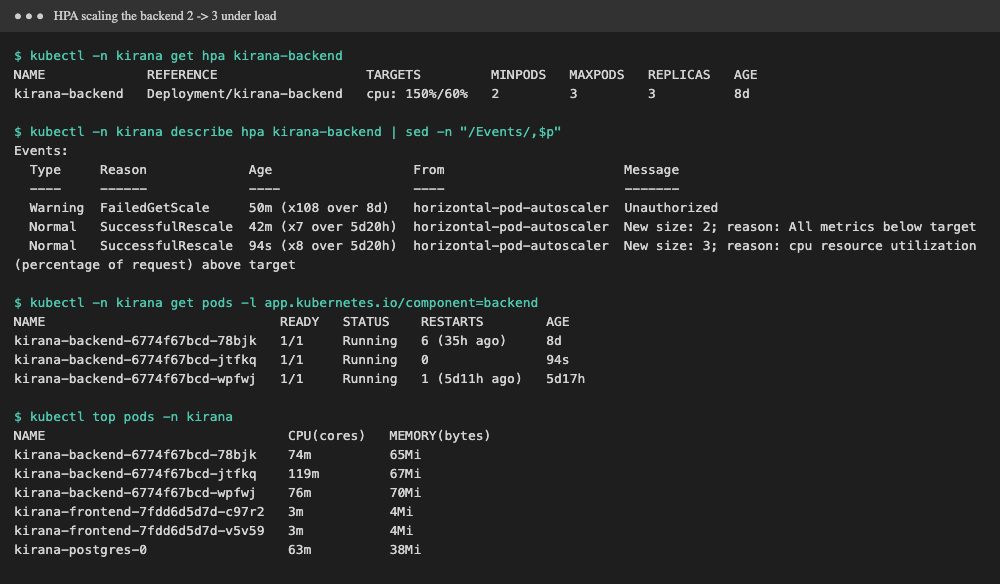

## 7. Monitoring

```bash
helm repo add prometheus-community https://prometheus-community.github.io/helm-charts
helm upgrade --install monitoring prometheus-community/kube-prometheus-stack --version 92.0.0 \
  -n monitoring --create-namespace -f final-devops-project/monitoring/kube-prometheus-stack-values.yaml --wait
kubectl -n monitoring port-forward svc/monitoring-grafana 3001:80                       # Grafana
kubectl -n monitoring port-forward svc/monitoring-kube-prometheus-prometheus 9090:9090  # Prometheus
```

The chart adds a **ServiceMonitor** (scrapes backend `/metrics`), a **PrometheusRule**
(`KiranaBackendDown`, `KiranaHighErrorRate`, `KiranaSlowRequests`) and a **Grafana dashboard** ConfigMap.

| Prometheus: 3/3 Kirana targets UP | Prometheus: Kirana alert rules loaded |
|---|---|
| 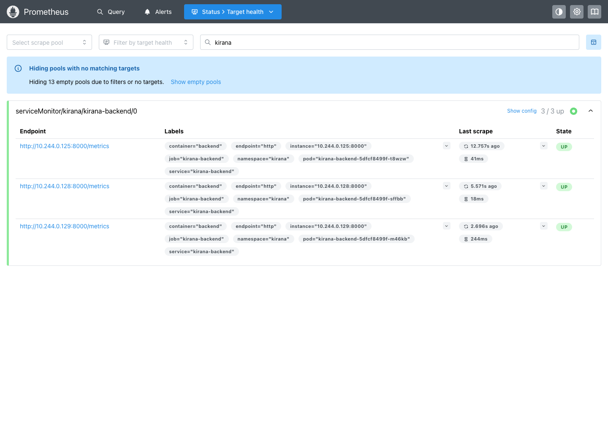 | 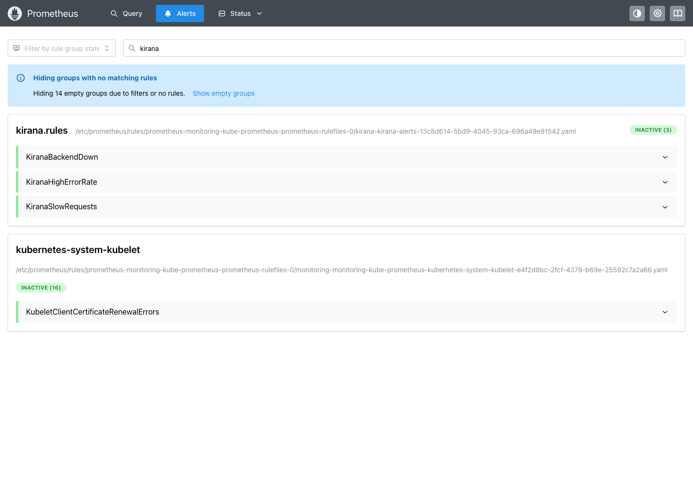 |

Grafana "Kirana Ledger" dashboard with live data: requests/s by endpoint, p95 latency, ledger entries by type,
Ready Pods per tier (backend scaled to 3) and CPU per Pod. "Error rate" is empty because no 5xx occurred. The gap
around 11:27 is a Prometheus restart while the 8 GB laptop's node was out of memory under the load test; the
higher p95 at the same time comes from the same cause.

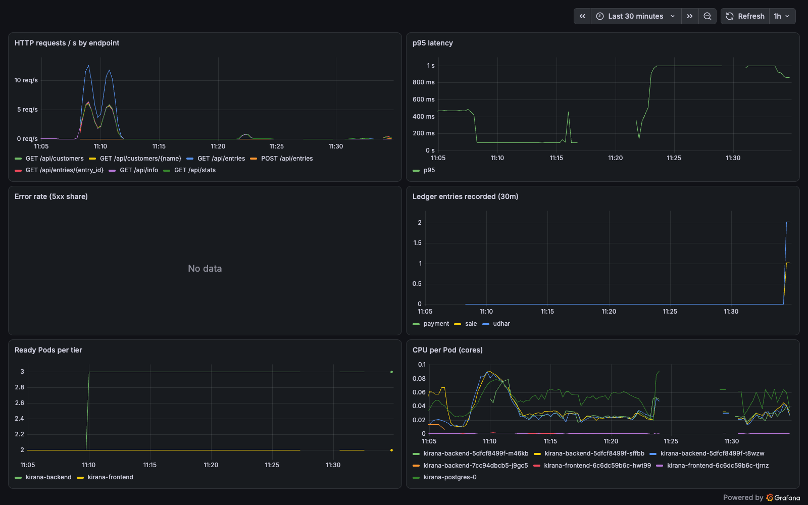

---

## 8. Live demo, recorded: commit → pipeline → deployment updates

This is the M10 flow, done for real on 2026-10-16 and captured in
[output-gitops-rollout.txt](output-gitops-rollout.txt):

| Step | Commit | What happened |
|---|---|---|
| 1 | `fb74dbf` release 2.1.0 | Pipeline 13/13 green, images pushed to GHCR as `:<sha>` |
| 2 | `c8e01c9` promote | One-line change in `values-minikube.yaml`; Argo CD synced by itself… |
| 3 | — | …and the new Pods crash-looped: `exec format error` (incident 2). The 2.0.0 Pods kept serving. |
| 4 | `c722d8a` fix | Multi-arch build; pipeline 17/17 green |
| 5 | `41ee491` promote | Argo CD rolled 2.0.0 → 2.1.0 in about 6 minutes with zero downtime |

| Before (2.0.0, through the Ingress) | After (2.1.0) |
|---|---|
| 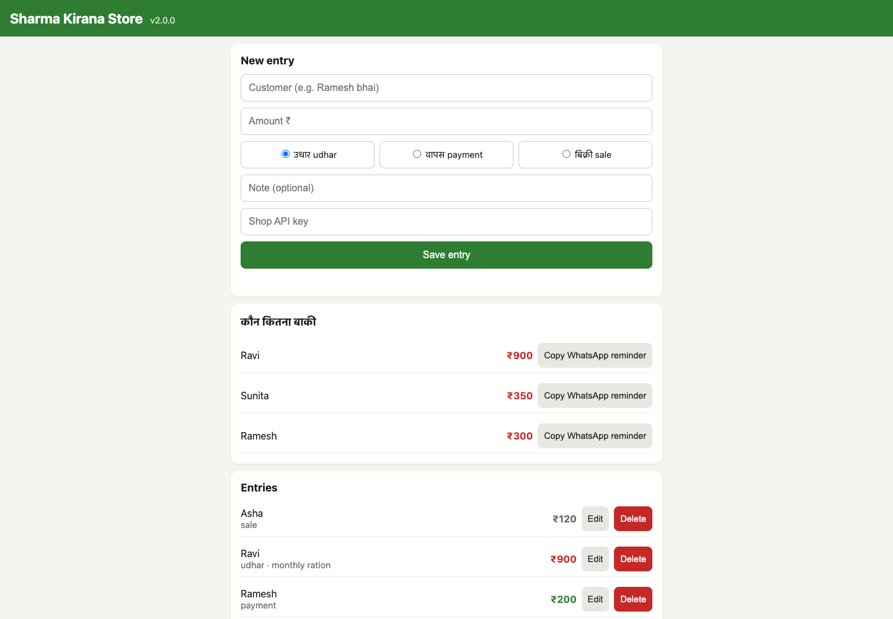 |  |

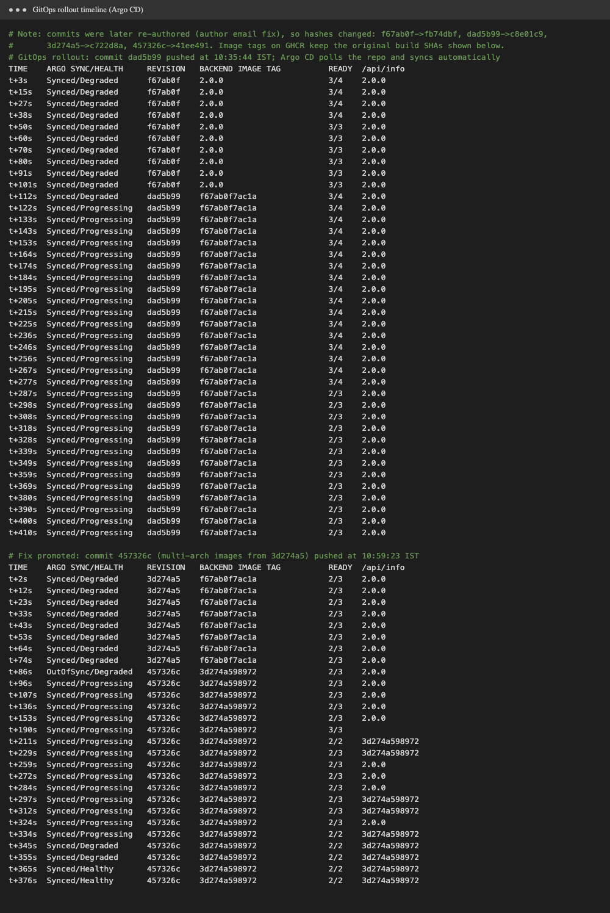

Commits were later re-authored to fix the author email, so the hashes in the captured logs differ from the ones
above (f67ab0f→fb74dbf, dad5b99→c8e01c9, 3d274a5→c722d8a, 457326c→41ee491). GHCR image tags keep the
original build SHAs; the files contain the same mapping note.

## 9. Troubleshooting: two real incidents

### Incident 1 — PostgreSQL CrashLoopBackOff

On minikube, PostgreSQL went into a restart loop and every API Pod showed `0/1`.
[output-incident-before.txt](output-incident-before.txt) has the investigation: the liveness probe
(`pg_isready`, 1 s timeout) timed out because the 8 GB node was at 419 % CPU with 34 Pods, so Kubernetes kept
killing a healthy database. Fixes, shipped as releases:

1. Postgres liveness made patient (30 s initial delay, 5 s timeout, 6 failures) and all probe timeouts made configurable.
2. The API no longer needs the DB to boot (release 1.0.1, [output-release-1.0.1.txt](output-release-1.0.1.txt)).
3. HPA max lowered to 3 on minikube.

[`resilience-check.sh`](final-devops-project/troubleshooting/resilience-check.sh) then deletes the Postgres Pod
under live traffic. In [output-resilience.txt](output-resilience.txt), `/ready` returns 503 for a few seconds and
the API Pods drop out of the Service, but RESTARTS stays at 0, because liveness (`/health`) never touches the
database. These outputs come from the first, single-tier version of the chart (`kirana-api`).

### Incident 2 — `exec format error` during a GitOps rollout

[output-incident-arch.txt](output-incident-arch.txt): after promoting release 2.1.0, the new backend Pod failed in
its `migrate` init container and the new frontend Pod crash-looped, both with `exec format error`. The node is
`arm64` (Apple Silicon); the images were `linux/amd64` only. The rolling update protected users: the new Pods
never became Ready, so the 2.0.0 Pods kept serving. Fix: build both architectures on native runners, scan all
four images and publish one multi-arch tag (section 4).

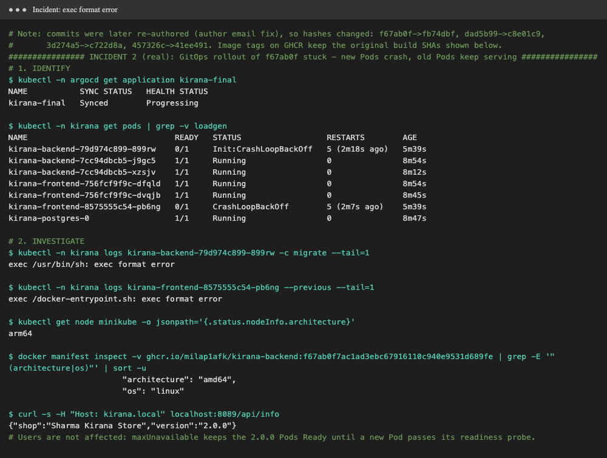

Checks used in both incidents:

```bash
kubectl -n kirana get pods -o wide
kubectl -n kirana describe pod <pod>
kubectl -n kirana logs <pod> [-c <container>] --previous
kubectl -n kirana get events --sort-by=.lastTimestamp
kubectl get node -o jsonpath='{.items[0].status.nodeInfo.architecture}'
docker manifest inspect -v <image> | grep architecture
```
