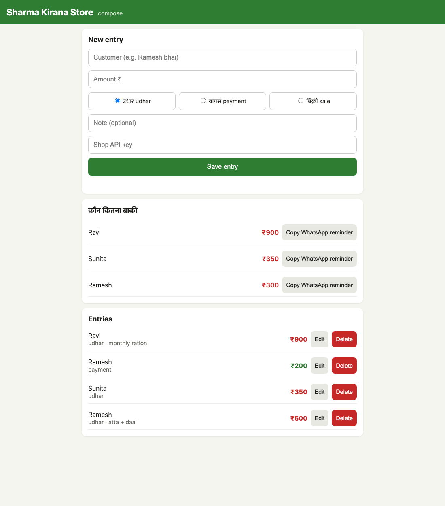

# Session 21 — Final DevOps Project: Kirana Ledger

The capstone for the course, following the
[Session 21 brief](https://github.com/Nency-Ravaliya/devops-heros/tree/main/session21-python).
The brief's reference app is *TaskBoard*; the rules say the application domain must be your own, so this
project is **Kirana Ledger**, a credit book (*udhar khata*) for a small Indian grocery shop. The DevOps layer
follows the same architecture as TaskBoard.

| Document | What it covers |
|---|---|
| **README.md** (this file) | Project overview, requirements, how to run every layer |
| [GRADING.md](GRADING.md) | The rubric (M1–M10, 100 points) and a self-assessment against it, with evidence |
| [student-guide.md](student-guide.md) | Submission instructions, evidence checklist and the final demo script |

---

## 1. The application

A shopkeeper records three kinds of entries:

| Type | Meaning | Effect on balance |
|---|---|---|
| `udhar` | Goods given on credit | balance goes **up** |
| `payment` | Customer pays back credit | balance goes **down** |
| `sale` | Cash sale | no effect |

The app shows *कौन कितना बाकी* (who owes how much), biggest balance first, with a one-tap WhatsApp reminder:
`Ramesh ji, ₹300 बाकी हैं.` Customer names are stored without honorifics, so "Ramesh bhai", "Rameshbhai" and
"Shri Ramesh ji" all count as one customer, "Ramesh".



Mobile layout: [screenshots/app-compose-mobile.png](screenshots/app-compose-mobile.png)

### Architecture

```text
Developer ──git push──> GitHub ──> GitHub Actions (s21-final.yml)
                                     ├─ 1  pytest + flake8 + coverage ≥ 80 %, frontend build
                                     ├─ 2  SAST (Semgrep)
                                     ├─ 3  SCA (pip-audit, npm audit, Trivy fs)
                                     ├─ 4  Secret scan (Gitleaks)
                                     ├─ 5  IaC scan (Trivy config, terraform validate, helm lint)
                                     ├─ 6  Docker build: backend + frontend
                                     ├─ 7  Trivy image scan: backend + frontend
                                     ├─ 8  Security gate (all of 2–7 must pass)
                                     ├─ 9  Push to GHCR, tagged with the git SHA
                                     └─ 10 helm upgrade --install on a kind cluster + smoke test

Terraform ──> AWS VPC (2 public + 2 private subnets, NAT) ──> EKS + managed node group, ECR

Kubernetes (namespace kirana, Helm chart "kirana")
   Ingress kirana.local ── /     ──> frontend Service ──> Nginx Pods (HPA 2–4)
                        └─ /api  ──> backend Service  ──> FastAPI Pods (HPA 2–5) ──> PostgreSQL StatefulSet + PVC
                                                             └─ /metrics ──> ServiceMonitor ──> Prometheus ──> Grafana
Argo CD keeps the cluster in sync with helm/kirana on main (GitOps).
```

### Tech stack

| Layer | Choice |
|---|---|
| Frontend | Vanilla JS + CSS built with Vite, served by unprivileged Nginx (multi-stage image) |
| Backend | FastAPI, SQLAlchemy 2, Pydantic, `prometheus-fastapi-instrumentator` |
| Database | PostgreSQL 17, schema managed by Alembic (`0001_create_entries`) |
| Tests | pytest + pytest-cov against a throwaway SQLite DB per test; flake8 |
| Containers | Docker, Docker Compose (postgres → migrate → backend → frontend) |
| CI/CD | GitHub Actions, GHCR, Helm deploy to kind |
| Security | Semgrep, pip-audit, npm audit, Gitleaks, Trivy (fs, config, image) |
| IaC | Terraform: VPC, subnets, NAT, EKS, node group, EBS CSI add-on, KMS, ECR |
| Kubernetes | Helm chart: Deployments, StatefulSet, Services, Ingress, HPA, ConfigMap, Secret |
| Observability | kube-prometheus-stack, ServiceMonitor, PrometheusRule (3 alerts), Grafana dashboard |
| GitOps | Argo CD `Application` |

### REST API

| Method | Path | Purpose |
|---|---|---|
| GET | `/health` | Liveness: process is up, never touches the DB |
| GET | `/ready` | Readiness: DB answers `SELECT 1`, else 503 |
| GET | `/metrics` | Prometheus metrics, incl. `kirana_ledger_entries_total{type}` |
| GET | `/api/info` | Shop name and version |
| GET | `/api/entries` | List entries (optional `?customer=`) |
| GET | `/api/entries/{id}` | One entry |
| POST | `/api/entries` | Create entry (`X-API-Key` header) |
| PUT | `/api/entries/{id}` | Update entry (`X-API-Key`) |
| DELETE | `/api/entries/{id}` | Delete entry (`X-API-Key`) |
| GET | `/api/customers` | Outstanding balances, biggest first, with reminder text |
| GET | `/api/customers/{name}` | One customer's balance |

Swagger UI: `/docs` on the backend.

---

## 2. Requirements

| Requirement from the brief | Where it is |
|---|---|
| Frontend, backend, PostgreSQL | [`application/frontend`](final-devops-project/application/frontend), [`application/backend`](final-devops-project/application/backend) |
| ≥ 4 REST APIs, responsive UI | 11 endpoints above; desktop + mobile screenshots |
| Git/GitHub | this repo, `main` |
| Automated tests | [`backend/tests`](final-devops-project/application/backend/tests): 17 tests, 93 % coverage |
| Docker | two Dockerfiles + [`docker/docker-compose.yml`](final-devops-project/docker/docker-compose.yml) |
| GitHub Actions | [`.github/workflows/s21-final.yml`](../.github/workflows/s21-final.yml) |
| Security scan | Trivy + Semgrep + Gitleaks + pip-audit/npm audit; config in [`security/`](final-devops-project/security) |
| Container registry | GHCR: `ghcr.io/milap1afk/kirana-backend`, `ghcr.io/milap1afk/kirana-frontend` |
| Terraform | [`terraform/`](final-devops-project/terraform) |
| Kubernetes + Helm | [`k8s/`](final-devops-project/k8s), [`helm/kirana`](final-devops-project/helm/kirana), plain YAML in [`kubernetes/`](final-devops-project/kubernetes) |
| Ingress, HPA | [`ingress.yaml`](final-devops-project/helm/kirana/templates/ingress.yaml), [`hpa.yaml`](final-devops-project/helm/kirana/templates/hpa.yaml) |
| Prometheus/Grafana | [`monitoring/`](final-devops-project/monitoring) + chart templates `servicemonitor`, `prometheusrule`, `grafana-dashboard` |
| Troubleshooting | [`troubleshooting/resilience-check.sh`](final-devops-project/troubleshooting/resilience-check.sh), incident write-up below |

Tools used locally: macOS (Apple Silicon, 8 GB), Colima (Docker 29), minikube, Helm, Terraform 1.16, kubectl.

### Repository layout

```text
session-21-final-devops-project/
├── README.md  GRADING.md  student-guide.md
├── screenshots/                     # app (desktop, mobile), compose
├── output-*.txt, compose-up-build.txt  # captured terminal output (evidence)
└── final-devops-project/
    ├── application/
    │   ├── backend/                 # FastAPI app, alembic/, tests/, Dockerfile, pytest.ini
    │   └── frontend/                # Vite source, nginx.conf.template, multi-stage Dockerfile
    ├── docker/docker-compose.yml    # full local stack
    ├── terraform/                   # VPC + EKS + ECR, terraform.tfvars.example, output.txt
    ├── k8s/namespace.yaml           # bootstrap
    ├── helm/kirana/                 # the chart (values.yaml, values-minikube.yaml, templates/, dashboards/)
    ├── kubernetes/                  # same resources as plain YAML, rendered by render.sh
    ├── monitoring/                  # kube-prometheus-stack values, ServiceMonitor, PrometheusRule
    ├── gitops/argocd-application.yaml
    ├── security/                    # trivy.yaml, .gitleaks.toml, .semgrepignore
    └── troubleshooting/resilience-check.sh
```

---

## 3. Run it locally (Docker Compose)

```bash
cd session-21-final-devops-project/final-devops-project
docker compose -f docker/docker-compose.yml up --build
```

| URL | What |
|---|---|
| http://localhost:3000 | the app (Nginx proxies `/api` to the backend) |
| http://localhost:8001/docs | Swagger UI (host port 8001, because 8000 is often taken) |
| http://localhost:8001/health · `/ready` · `/metrics` | ops endpoints |

The local API key for writes is `local-dev-key` (override with `API_KEY=...`). Stop with
`docker compose -f docker/docker-compose.yml down` (add `-v` to delete the database volume).

Last checked on 2026-10-16: all four services came up (`migrate` exited 0, backend healthy), and a POST through
`localhost:3000/api/entries` with "Shri Ramesh ji" stored the customer as `Ramesh` and returned the reminder
`Ramesh ji, ₹500 बाकी हैं.`. Full captured runs: [compose-up-build.txt](compose-up-build.txt),
[output-compose.txt](output-compose.txt) (all CRUD calls).

### Backend tests

```bash
cd final-devops-project/application/backend
python3.12 -m venv .venv && source .venv/bin/activate
pip install -r requirements-dev.txt
flake8 . && pytest -v --cov=app
```

Result: `17 passed`, total coverage **92.9 %** (CI fails below 80 %). Tests use a fresh SQLite file per test via
a FastAPI dependency override, never the real PostgreSQL.

---

## 4. CI/CD pipeline

[`.github/workflows/s21-final.yml`](../.github/workflows/s21-final.yml) runs on every push to `main` that touches
this project (and on PRs, without the push/deploy jobs). Images are tagged with `${{ github.sha }}`, never `latest`,
so every running Pod traces back to one commit.

Latest green run, all 13 jobs passing:
<https://github.com/milap1afk/devops-homework/actions/runs/37605411031> (commit `d00093d`). Its deploy job installed
the chart on kind and printed 2 backend + 2 frontend Pods `Running`, then smoke-tested the UI title, a POST and a
balance read through the frontend.

### Security scanning

| Stage | Tool | Blocks on |
|---|---|---|
| SAST | Semgrep (`p/python`, `p/fastapi`, `p/javascript`, `p/dockerfile`, `p/nginx`, `p/secrets`) | any finding |
| SCA | pip-audit, npm audit, Trivy fs | known vulnerable dependency |
| Secrets | Gitleaks over git history and files | any secret |
| IaC | Trivy config (Terraform, Helm, YAML, Dockerfiles), `terraform validate`, `helm lint` | HIGH/CRITICAL misconfig |
| Images | Trivy image, both tiers | fixable HIGH/CRITICAL CVE |

In the latest run Trivy reported **0** fixable HIGH/CRITICAL vulnerabilities in both images (backend:
Debian 13.7 + Python packages; frontend: Alpine 3.23.4). The Dockerfiles run `apt-get upgrade` / `apk upgrade` at
build time for that reason, and both images run as non-root (uid 10001 and 101).

---

## 5. Terraform (AWS)

[`terraform/`](final-devops-project/terraform) describes, in `ap-south-1`: a VPC with 2 public and 2 private
subnets, an internet gateway, a NAT gateway, route tables, an EKS cluster (secrets encrypted with KMS) with a
managed node group and the EBS CSI add-on, IAM roles, and an ECR repository with a lifecycle policy.

```bash
cd final-devops-project/terraform
cp terraform.tfvars.example terraform.tfvars    # never commit the real one
# delete the "offline_plan = true" line in terraform.tfvars to talk to a real AWS account
terraform init && terraform plan
terraform apply                                 # creates billable resources (EKS + NAT)
$(terraform output -raw kubeconfig_command)     # aws eks update-kubeconfig --region ap-south-1 --name kirana-eks
terraform destroy                               # always, when done
```

[`run.sh`](final-devops-project/terraform/run.sh) runs `init`, `fmt -check`, `validate` and `plan` offline with
dummy credentials; the result is in [`output.txt`](final-devops-project/terraform/output.txt):
**Plan: 26 to add, 0 to change, 0 to destroy.** `apply`/`destroy` against a real AWS account has not been run yet;
see [GRADING.md](GRADING.md#m7--terraform-15).

---

## 6. Kubernetes, Helm, Ingress, HPA

```bash
cd final-devops-project
kubectl apply -f k8s/namespace.yaml
kubectl -n kirana create secret generic kirana-secrets \
  --from-literal=API_KEY="$(openssl rand -hex 16)" --from-literal=POSTGRES_PASSWORD="$(openssl rand -hex 16)"
helm upgrade --install kirana helm/kirana -n kirana -f helm/kirana/values-minikube.yaml
kubectl -n kirana get pods,svc,ingress,hpa
helm list -n kirana
```

- **Backend Deployment**: an `initContainer` runs `alembic upgrade head` (retrying until Postgres is up);
  liveness `/health`, readiness `/ready`, startup probe; HPA 2–5 at 60 % CPU.
- **Frontend Deployment**: Nginx on 8080, HPA 2–4.
- **PostgreSQL StatefulSet** with a 1 Gi PVC and deliberately patient probes (see the incident below).
- **Services**: ClusterIP for all three tiers.
- **Ingress** `kirana.local`: `/api` → backend, `/` → frontend. Needs an Ingress controller
  (`minikube addons enable ingress`) and `kirana.local` in `/etc/hosts`.
- **Secrets** never live in Git: either `existingSecret` or `--set secrets.*` at install time.

On minikube the images are built locally and loaded with `minikube image load` (`pullPolicy: Never`).
[`gitops/argocd-application.yaml`](final-devops-project/gitops/argocd-application.yaml) lets Argo CD sync the chart
from `main` with auto-prune and self-heal.

## 7. Monitoring

```bash
helm repo add prometheus-community https://prometheus-community.github.io/helm-charts
helm upgrade --install monitoring prometheus-community/kube-prometheus-stack --version 92.0.0 \
  -n monitoring --create-namespace -f final-devops-project/monitoring/kube-prometheus-stack-values.yaml --wait
```

The chart then adds a **ServiceMonitor** (scrapes backend `/metrics`), a **PrometheusRule**
(`KiranaBackendDown`, `KiranaHighErrorRate`, `KiranaSlowRequests`) and a **Grafana dashboard** ConfigMap with
panels for requests/s by endpoint, p95 latency, 5xx share, ledger entries recorded, ready Pods per tier and CPU per Pod.

```bash
kubectl -n monitoring port-forward svc/monitoring-grafana 3001:80               # Grafana
kubectl -n monitoring port-forward svc/monitoring-kube-prometheus-prometheus 9090:9090  # Prometheus → Status → Targets
```

## 8. Troubleshooting: a real incident

On minikube, PostgreSQL went into a restart loop and every API Pod showed `0/1`.
[output-incident-before.txt](output-incident-before.txt) has the investigation: the liveness probe
(`pg_isready`, 1 s timeout) timed out because the 8 GB node was at 419 % CPU with 34 Pods, so Kubernetes kept
killing a healthy database. Fixes, shipped as releases:

1. Postgres liveness made patient (30 s initial delay, 5 s timeout, 6 failures) and all probe timeouts made configurable.
2. The API no longer needs the DB to boot (release 1.0.1, [output-release-1.0.1.txt](output-release-1.0.1.txt)).
3. HPA max lowered to 3 on minikube.

[`resilience-check.sh`](final-devops-project/troubleshooting/resilience-check.sh) then deletes the Postgres Pod
under live traffic. [output-resilience.txt](output-resilience.txt): `/ready` returns 503 for a few seconds and the
API Pods drop out of the Service, but RESTARTS stays at 0, because liveness (`/health`) never touches the database.
These outputs come from the first, single-tier version of the chart (`kirana-api`); the current chart split it
into `kirana-backend` and `kirana-frontend` and kept the same probe design.

Common checks used throughout:

```bash
kubectl -n kirana get pods -o wide
kubectl -n kirana describe pod <pod>
kubectl -n kirana logs <pod> --previous
kubectl -n kirana get events --sort-by=.lastTimestamp
kubectl -n kirana get endpointslices
```
